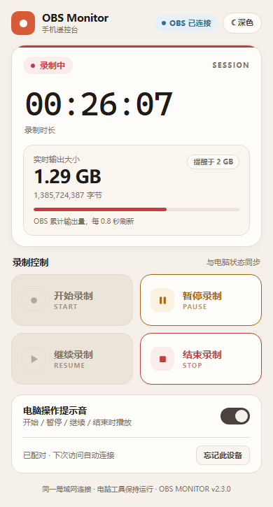

<div align="center">
  

  <h1>OBS Monitor</h1>

  <p>
    <strong>简体中文</strong> · <a href="README_EN.md">English</a>
  </p>

  <p><strong>Windows 桌面端 OBS Studio 录制监看台与免 App 局域网手机遥控器</strong></p>
  <p>实时掌握录制时长与真实输出字节数，手机扫码即可在桌边稳妥开始、暂停、继续或结束录制。</p>

  <p>
    <a href="https://github.com/ElmaTony/obs-monitor/actions/workflows/ci.yml">
      
    </a>
  </p>

  <p>
    <a href="#下载"><strong>下载 v2.3.3</strong></a> ·
    <a href="#界面预览">界面预览</a> ·
    <a href="#快速开始">快速开始</a> ·
    <a href="#工作机制与安全设计">工作机制</a> ·
    <a href="#常见问题">常见问题</a> ·
    <a href="#开发">开发</a> ·
    <a href="CHANGELOG.md">更新记录</a>
  </p>

  <br>

  <picture>
    <source media="(prefers-color-scheme: dark)" srcset="assets/desktop-dark.png">
    <source media="(prefers-color-scheme: light)" srcset="assets/desktop-light.png">
    
  </picture>

  <p><sub>图示为示例数据 · 自动适配 GitHub 浅色（暖砂珊瑚）/ 深色（暖炭珊瑚 · 无底色描边）主题</sub></p>
</div>

---

## 为什么需要 OBS Monitor

| 痛点场景 | OBS Monitor 的解决方式 |
| --- | --- |
| **全屏游戏 / 录课切窗打断画面** | 手机摆在桌边实时查看录制状态、时长与容量；每次操作成功均由电脑端播报提示音，不用切出全屏即可盲听确认。 |
| **录像文件显示 `0 KB` 心里没底** | 直接读取 OBS WebSocket v5 的 `GetRecordStatus.outputBytes`，同步展示易读容量与精确到字节的累计输出量，不依赖资源管理器磁盘属性。 |
| **误触连点或极低帧率提前报错** | 四个按钮严格随 OBS 实际状态解锁；指令发出后等待编码器稳定确认（至少 3 个视频帧周期，停止录制兼容最高 64 帧 NVENC 收尾缓冲）才生效，绝不自动重放未知请求。 |
| **装插件、配公网转发太繁琐** | 原生桌面客户端 + 内嵌局域网手机网页，无需下载手机 App，无外部 CDN 或云端中转；持久配对后关掉浏览器、锁屏甚至重启电脑软件都能自动复连。 |

---

## 界面预览

### 手机遥控台与设置面板

<table>
  <tr>
    <td align="center" width="33%">
      <br>
      <sub>手机端 · 浅色（暖砂珊瑚）</sub>
    </td>
    <td align="center" width="33%">
      <br>
      <sub>手机端 · 深色（暖炭珊瑚）</sub>
    </td>
    <td align="center" width="34%">
      <br>
      <sub>桌面端 · 连接与提醒设置</sub>
    </td>
  </tr>
</table>

<details>
<summary>展开并排对比桌面端浅色 / 深色主题完整截图</summary>

<br>

<table>
  <tr>
    <td align="center" width="50%">
      <br>
      <sub>浅色 · 暖砂珊瑚</sub>
    </td>
    <td align="center" width="50%">
      <br>
      <sub>深色 · 暖炭珊瑚（无底色描边）</sub>
    </td>
  </tr>
</table>

</details>

---

## 下载

当前稳定版本：**v2.3.3**（所有发行包均已内置完整运行环境，无需单独安装 Python）。

| 平台 | 安装版（推荐） | 便携版（免安装） | 单文件 EXE |
| --- | --- | --- | --- |
| **Windows x64**（Intel / AMD） | [下载 Setup](https://github.com/ElmaTony/obs-monitor/releases/download/v2.3.3/obs-monitor-2.3.3-windows-x64-setup.exe) | [下载 ZIP](https://github.com/ElmaTony/obs-monitor/releases/download/v2.3.3/obs-monitor-2.3.3-windows-x64-portable.zip) | [下载 EXE](https://github.com/ElmaTony/obs-monitor/releases/download/v2.3.3/obs-monitor-2.3.3-windows-x64.exe) |
| **Windows ARM64**（ARM 设备） | [下载 Setup](https://github.com/ElmaTony/obs-monitor/releases/download/v2.3.3/obs-monitor-2.3.3-windows-arm64-setup.exe) | [下载 ZIP](https://github.com/ElmaTony/obs-monitor/releases/download/v2.3.3/obs-monitor-2.3.3-windows-arm64-portable.zip) | [下载 EXE](https://github.com/ElmaTony/obs-monitor/releases/download/v2.3.3/obs-monitor-2.3.3-windows-arm64.exe) |

- **安装版**：自动创建开始菜单快捷方式并提供标准卸载入口。
- **便携版**：解压至任意目录即可运行，适合多设备拷贝或免安装使用。
- **单文件 EXE**：单个可执行文件即开即用，无需解压。

[完整发行源码](https://github.com/ElmaTony/obs-monitor/releases/download/v2.3.3/obs-monitor-2.3.3-source.zip) · [SHA-256 校验清单](https://github.com/ElmaTony/obs-monitor/releases/download/v2.3.3/SHA256SUMS.txt) · [全部历史版本](https://github.com/ElmaTony/obs-monitor/releases)

> **运行要求**：Windows 10 / 11 x64 或 Windows 11 ARM64，以及支持 **WebSocket v5** 的 OBS Studio（OBS 28 及以上版本已内置）。

<details>
<summary>在 PowerShell 中校验安装包 SHA-256 摘要</summary>

```powershell
Get-FileHash .\obs-monitor-2.3.3-windows-x64-setup.exe -Algorithm SHA256
```

将输出的哈希值与 [SHA256SUMS.txt](https://github.com/ElmaTony/obs-monitor/releases/download/v2.3.3/SHA256SUMS.txt) 中对应条目比对即可。

</details>

---

## 快速开始

### 1. 在 OBS 中启用 WebSocket 服务
打开 OBS Studio，进入顶部菜单 **工具 → WebSocket 服务器设置**，勾选 **启用 WebSocket 服务器**（默认端口 `4455`），如开启了身份验证请记下服务器密码。

### 2. 启动桌面控制台
运行 OBS Monitor（首次启动会自动弹出使用说明，之后随时可点击右上角 **?** 查看）：
- 软件会自动读取本机 OBS WebSocket 配置并建立连接；
- 如未自动连上或需连接局域网内另一台 OBS 主机，点击右上角 **设置** 填写对应地址、端口和密码并保存应用；
- 连接成功后即可通过主界面四个按钮控制录制，并在右侧管理操作提示音总开关、分项开关与试听。

### 3. 连接手机遥控网页
1. 确保手机与电脑处于**同一局域网**（电脑插网线、手机连同一路由器的 Wi-Fi 即可）。
2. 用手机扫描右侧二维码，或点击 **复制链接** 在手机浏览器中打开（默认网页端口 `8765`；多网卡时可在下拉框切换局域网 IP）。
3. 首次配对后建议收藏为书签或添加到主屏幕；同一浏览器再次打开原地址即可自动恢复连接。

---

## 工作机制与安全设计

- **状态同步与防呆保护**
  - 桌面端约每 `0.5` 秒刷新一次，手机前台约每 `0.8` 秒刷新一次（切到后台自动暂停轮询省电，回到前台立即拉取）。
  - 断线或采样超过 `3` 秒未更新时，界面保留上次有效数据并立即锁定控制按钮，避免状态未知时盲目操作。
  - `GetRecordStatus.outputBytes` 反映 OBS 编码后的累计输出量；最终生成的 MKV / MP4 文件因包含容器封装信息，磁盘大小可能与之略有差异。
- **分级提示音与容量提醒**
  - 本地实时合成五种独立 PCM 提示音（开始、暂停、继续、结束、容量提醒，缓存受损时自动重建），支持总开关（桌面与手机实时联动）、分项勾选与试听。
  - 自定义容量阈值支持 `0.1`–`102400 GB`，每次录制达到阈值自动提醒一次；录制中途调高阈值或关闭提醒会自动重置触发状态。
- **持久配对与访问控制**
  - 通过 `HttpOnly; SameSite=Strict` 持久 Cookie 与浏览器本地存储保持配对；后台持续监测网络变化，优先选取手机可达的真实局域网地址并自动更新二维码。
  - 支持区分撤销：**忘记此设备**（手机端）仅解除当前浏览器配对；**重置所有手机配对**（桌面设置）立即吊销所有历史控制链接与已授权设备。
  - 以下情况需要重新配对：关闭无痕/隐私窗口、清除网站数据、更换浏览器、电脑端重置了所有配对，或电脑局域网 IP / 网页端口发生变化。
- **本地凭据隔离**
  - 常规配置、主题偏好及首次说明状态保存在 `%APPDATA%/OBSAudioMonitor/config.json`（沿用该目录名以兼容旧版）。
  - OBS WebSocket 密码与手机配对密钥分别独立加密保存在 **Windows 凭据管理器** 中，不会明文写入配置文件或程序目录；手机端接口亦不会返回 OBS 密码及本机录制文件路径。
  - 手机遥控服务面向可信局域网，采用 HTTP 通信，请勿将其端口映射至公网，控制链接也请仅分享给可信设备。

---

## 常见问题

<details>
<summary><strong>手机打不开遥控页面怎么办？</strong></summary>

1. 确认电脑端 OBS Monitor 正在运行，且右侧手机遥控状态显示「已开启」。
2. 确保手机访问的是工具显示的局域网地址（例如 `192.168.x.x:8765`）；`127.0.0.1` 仅限电脑本机访问。
3. 检查 Windows 防火墙是否允许 OBS Monitor 通过专用网络，并排查代理软件、VPN、访客 Wi-Fi 或路由器 AP 隔离。
4. 默认端口：OBS WebSocket 为 `4455`，手机遥控网页为 `8765`。

</details>

<details>
<summary><strong>为什么部分录制按钮处于灰色不可点状态？</strong></summary>

所有按钮严格跟随 OBS 当前实际状态：
- **未录制**：仅「开始」可用；
- **录制中**：仅「暂停」「结束」可用；
- **已暂停**：仅「继续」「结束」可用；
- **等待确认 / 断线 / 数据过期**：所有控制按钮暂时锁定，待 OBS 确认或恢复连接后自动解锁。

</details>

<details>
<summary><strong>点击暂停时 OBS 提示无法暂停？</strong></summary>

请打开 OBS 的 **设置 → 输出 → 录像**：若录像编码器选择了「使用推流编码器」，OBS 不支持暂停录制。将其更改为独立的录像编码器（如 NVENC、QuickSync、x264 等）即可正常暂停与继续。

</details>

<details>
<summary><strong>关闭 OBS Monitor 会中断正在进行的录制吗？</strong></summary>

不会。关闭 OBS Monitor 只会断开 WebSocket 连接并停止局域网手机网页服务，OBS 中正在进行的录制会继续正常运行，你仍可在 OBS 主界面中直接控制。

</details>

<details>
<summary><strong>如何平滑升级到新版本？</strong></summary>

升级前先退出正在运行的 OBS Monitor：
- **安装版**：直接运行新版安装程序覆盖安装；
- **便携版**：解压新版压缩包至新目录运行；
- **单文件 EXE**：直接替换原 `obs-monitor.exe`。

同一 Windows 用户的配置、OBS 密码与手机配对均会保留，OBS 中正在进行的录制也不会受影响。

</details>

---

## 开发

### 环境要求
- Windows 10 / 11
- Python 3.12+
- Node.js 22+（用于运行手机前端逻辑与竞态测试）

### 源码运行

```powershell
git clone https://github.com/ElmaTony/obs-monitor.git
cd obs-monitor
python -m venv .venv
.\.venv\Scripts\python.exe -m pip install -r requirements-dev.txt
.\.venv\Scripts\python.exe main.py
```

### 运行测试

```powershell
.\.venv\Scripts\python.exe -B -m unittest discover -v
node test_mobile.cjs
node test_mobile_races.cjs
node test_mobile_pairing.cjs
```

- **自动化覆盖**：共 190 项 Python 测试与 49 项手机脚本测试，覆盖录制控制、状态确认、极低帧率编码器收尾、原始字节计数、提示音回放与缓存、设置校验、持久配对、断网恢复、桌面 UI 交互与乱序请求竞争。
- **持续集成与发行验证**：源码在 Windows x64 与 ARM64 原生运行器上自动执行 [GitHub Actions 检查](https://github.com/ElmaTony/obs-monitor/actions)；每次发版包均在双架构运行器上完成模拟 OBS WebSocket v5 联调、单实例保护及静默安装/卸载冒烟验收。
- **实机基线**：2026-11-16 在 Windows x64 真实 OBS Studio 33.0.1（1080p60 / NVENC H.264 / MKV）与安卓 Chrome 上完成两端控制、原始字节一致性、无参数复连、重启保配对及每 6 秒一帧极限收尾实测。

### 自行构建发行包
完整发行源码包（`obs-monitor-2.3.3-source.zip`）附带打包脚本与 `BUILDING.md`，可在原生 x64 或 ARM64 Windows 环境中构建安装版、便携版与单文件程序。

历史变更与协作规范详见 [CHANGELOG.md](CHANGELOG.md)、[CONTRIBUTING.md](CONTRIBUTING.md) 与 [SECURITY.md](SECURITY.md)。

---

## 许可证

本项目基于 [GPL-3.0-only](LICENSE) 开源发布。第三方依赖组件的许可声明见 [NOTICE.txt](NOTICE.txt) 与 [licenses/](licenses/)。

OBS Studio 需由用户单独安装；OBS Monitor 为独立开源项目，与 OBS Studio 官方无隶属关系。
