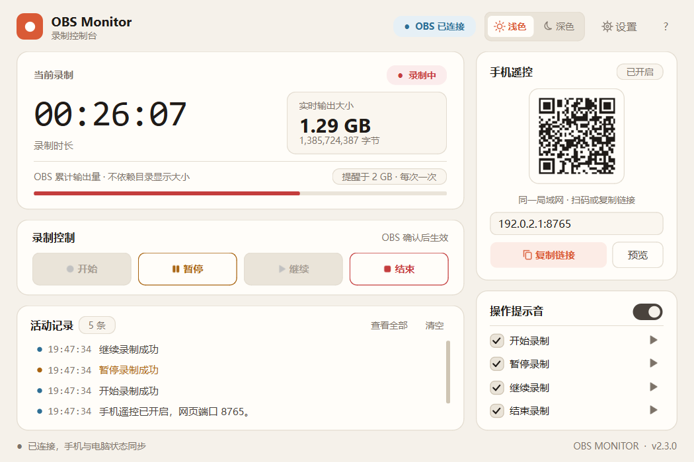
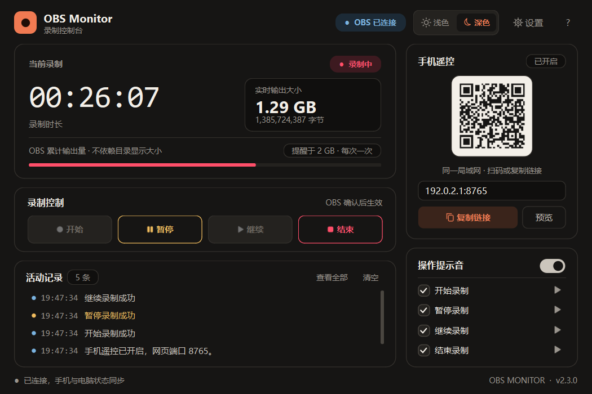
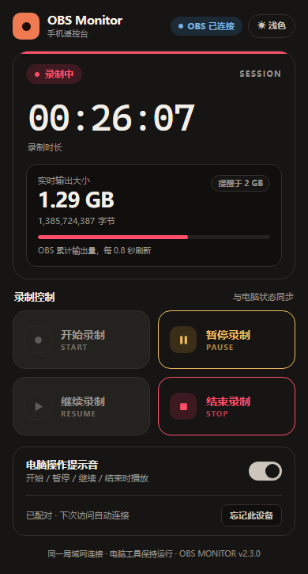
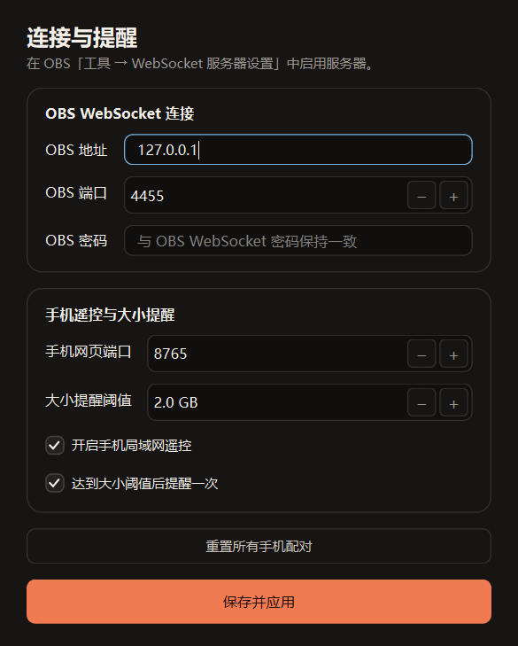

<div align="center">
  

  <h1>OBS Monitor</h1>

  <p>
    <strong>简体中文</strong> · <a href="README_EN.md">English</a>
  </p>

  <p><strong>轻量、可靠的 OBS Studio 桌面录制控制台与局域网手机遥控器</strong></p>
  <p>实时掌握录制时长与真实输出字节数，手机扫码即可随手开始、暂停、继续或结束录制。</p>

  <p>
    <a href="#下载"><strong>下载 v2.3.3</strong></a> ·
    <a href="#界面预览">界面预览</a> ·
    <a href="#快速开始">快速开始</a> ·
    <a href="#常见问题">常见问题</a> ·
    <a href="CHANGELOG.md">更新记录</a> ·
    <a href="https://github.com/ElmaTony/obs-monitor/issues">反馈问题</a>
  </p>

  <br>

  <picture>
    <source media="(prefers-color-scheme: dark)" srcset="assets/desktop-dark.png">
    <source media="(prefers-color-scheme: light)" srcset="assets/desktop-light.png">
    
  </picture>

  <p><sub>图示为示例数据 · 自动随系统浅色 / 深色主题展示对应预览</sub></p>
</div>

---

## 核心特性

| 能力 | 说明 |
| --- | --- |
| **确认式录制控制** | 支持开始、暂停、继续、结束四项操作；命令发出后等待 OBS 实际状态确认才生效并播放反馈，防止重复提交，并兼容极低帧率下的编码器收尾等待。 |
| **实时真实输出大小** | 直接读取 OBS WebSocket v5 的 `GetRecordStatus.outputBytes`，同步展示原始字节数与易读容量，录像文件属性仍显示 `0 KB` 时同样实时跳动。 |
| **免 App 手机遥控** | 同一局域网下扫码或打开链接即可控制录制并开关电脑提示音；采用持久配对，关闭浏览器、切换 App 或重启电脑工具后访问原地址自动恢复连接。 |
| **分级操作提示音 & 容量提醒** | 开始、暂停、继续、结束四种操作各配有独立提示音，支持总开关、分项勾选与现场试听；达到自定义容量阈值后每次录制自动提醒一次。 |
| **结构化活动记录** | 主界面以带状态色点与等宽时间戳的事件流展示最新动态，并支持打开独立完整日志窗口（实时同步、缩放重排、一键复制）与一键清空。 |
| **暖砂 / 暖炭双主题紧凑界面** | `840×560` 固定紧凑窗口（小屏自动安全兜底），支持「暖砂珊瑚」浅色与「暖炭珊瑚 · 无底色描边」深色平滑切换、Windows 同色标题栏、单实例保护与首次启动指引。 |

---

## 界面预览

### 桌面端双主题

<table>
  <tr>
    <td align="center" width="50%">
      <br>
      <sub>浅色 · 暖砂珊瑚</sub>
    </td>
    <td align="center" width="50%">
      <br>
      <sub>深色 · 暖炭珊瑚（无底色描边）</sub>
    </td>
  </tr>
</table>

### 手机遥控网页 & 设置窗口

<details>
<summary>展开查看手机双主题遥控台与桌面分组设置界面</summary>

<br>

<table>
  <tr>
    <td align="center" width="33%">
      <br>
      <sub>手机端 · 浅色</sub>
    </td>
    <td align="center" width="33%">
      <br>
      <sub>手机端 · 深色</sub>
    </td>
    <td align="center" width="34%">
      <br>
      <sub>桌面端 · 连接与提醒设置</sub>
    </td>
  </tr>
</table>

</details>

---

## 下载

当前稳定版本：**v2.3.3**（所有安装包均已内置完整运行环境，无需安装 Python）。

| 平台 | 安装版（推荐） | 便携版（免安装） | 单文件 EXE |
| --- | --- | --- | --- |
| **Windows x64**（Intel / AMD） | [下载 Setup](https://github.com/ElmaTony/obs-monitor/releases/download/v2.3.3/obs-monitor-2.3.3-windows-x64-setup.exe) | [下载 ZIP](https://github.com/ElmaTony/obs-monitor/releases/download/v2.3.3/obs-monitor-2.3.3-windows-x64-portable.zip) | [下载 EXE](https://github.com/ElmaTony/obs-monitor/releases/download/v2.3.3/obs-monitor-2.3.3-windows-x64.exe) |
| **Windows ARM64**（ARM 设备） | [下载 Setup](https://github.com/ElmaTony/obs-monitor/releases/download/v2.3.3/obs-monitor-2.3.3-windows-arm64-setup.exe) | [下载 ZIP](https://github.com/ElmaTony/obs-monitor/releases/download/v2.3.3/obs-monitor-2.3.3-windows-arm64-portable.zip) | [下载 EXE](https://github.com/ElmaTony/obs-monitor/releases/download/v2.3.3/obs-monitor-2.3.3-windows-arm64.exe) |

- **安装版**：自动创建开始菜单快捷方式并提供标准卸载入口。
- **便携版**：解压至任意目录即可运行，适合多设备拷贝或免安装使用。
- **单文件 EXE**：单个可执行文件即开即用，无需解压。

[完整发行源码](https://github.com/ElmaTony/obs-monitor/releases/download/v2.3.3/obs-monitor-2.3.3-source.zip) · [SHA-256 校验清单](https://github.com/ElmaTony/obs-monitor/releases/download/v2.3.3/SHA256SUMS.txt) · [全部历史版本](https://github.com/ElmaTony/obs-monitor/releases)

> **运行要求**：Windows 10 / 11 x64 或 Windows 11 ARM64，以及支持 **WebSocket v5** 的 OBS Studio（OBS 28 及以上版本已内置）。

---

## 快速开始

### 1. 在 OBS 中启用 WebSocket 服务
打开 OBS Studio，进入顶部菜单 **工具 → WebSocket 服务器设置**，勾选启用服务器（默认端口 `4455`），记下设置的密码（如启用身份验证）。

### 2. 启动桌面控制台
运行 OBS Monitor，首次启动会自动弹出使用说明（之后随时可点击右上角 **?** 再次查看）：
- 工具会自动尝试读取本机 OBS WebSocket 配置；
- 若未自动连上，点击右上角 **设置**，核对 OBS 地址、端口和密码并保存应用；
- 连接成功后即可通过主界面四个录制按钮控制 OBS，右侧可管理操作提示音总开关、分项开关与试听。

### 3. 连接手机遥控网页
1. 确保手机与电脑处于**同一局域网**（电脑插网线、手机连同一路由器的 Wi-Fi 即可）。
2. 使用手机扫描桌面右侧二维码，或点击 **复制链接** 在手机浏览器中打开（默认端口 `8765`）。
3. 首次配对成功后可将页面收藏为书签或添加到主屏幕；之后在同一浏览器打开该地址即可自动恢复连接。

---

## 使用说明与工作原理

### 手机配对与连接恢复
- **无感重连**：录制过程中可以切去其他 App、锁屏、关闭标签页甚至重启电脑端 OBS Monitor，重新打开页面后会立即同步最新状态。
- **自动适配网络变化**：后台会监测网卡变化并自动刷新二维码，优先选择手机可达的局域网地址，避免被虚拟网卡抢占。
- **撤销配对**：
  - 手机端 **忘记此设备**：仅清除当前浏览器的配对凭据；
  - 桌面设置 **重置所有手机配对**：立即吊销所有历史配对链接与已授权浏览器，全部设备需重新扫码。
- **以下情况需要重新配对**：使用无痕模式关闭窗口、清除浏览器网站数据、更换浏览器、电脑端重置了所有配对，或电脑局域网 IP / 网页端口发生变化。
- **安全提示**：控制链接包含局域网遥控凭证，请仅在可信局域网中使用并只分享给可信设备；手机遥控期间需保持桌面端运行。

### 实时输出大小与状态同步
- **为何与资源管理器显示不同**：录制过程中系统文件属性常暂时停留为 `0 KB`。OBS Monitor 读取的是 OBS 内部累计输出量（`GetRecordStatus.outputBytes`），不依赖磁盘文件属性也不按码率估算；最终生成的 MKV / MP4 文件因包含容器封装信息，体积可能与累计输出量略有差异。
- **同步节奏与防误触**：桌面端约每 `0.5` 秒刷新一次，手机前台约每 `0.8` 秒刷新一次（切到后台自动暂停轮询省电，回到前台立即拉取）。断线或状态过期时，界面会保留上次有效数据并暂时锁定录制按钮，防止盲操。

---

## 常见问题

<details>
<summary><strong>手机打不开遥控页面怎么办？</strong></summary>

1. 确认电脑端 OBS Monitor 正在运行，且右侧状态显示「已开启」。
2. 使用工具显示的局域网地址（例如 `192.168.x.x:8765`）；`127.0.0.1` 仅限电脑本机访问。
3. 检查 Windows 防火墙是否允许 OBS Monitor 通过专用网络，排查是否存在 VPN、代理软件、访客 Wi-Fi 或路由器 AP 隔离。
4. 默认端口：OBS WebSocket 为 `4455`，手机遥控网页为 `8765`。

</details>

<details>
<summary><strong>为什么部分录制按钮处于灰色不可点状态？</strong></summary>

所有按钮严格按照 OBS 当前实际状态启用：
- **未录制**：仅「开始」可用；
- **录制中**：仅「暂停」「结束」可用；
- **已暂停**：仅「继续」「结束」可用；
- **命令等待确认 / 断线 / 数据过期**：按钮暂时锁定，待收到 OBS 最新确认或恢复连接后自动解锁。

</details>

<details>
<summary><strong>点击暂停时 OBS 提示无法暂停？</strong></summary>

请检查 OBS 的 **设置 → 输出 → 录像**：若录像编码器选择了「使用推流编码器」，OBS 不支持暂停录制。将其更改为独立的录像编码器（如 NVENC、QuickSync、x264 等）即可正常暂停与继续。

</details>

<details>
<summary><strong>关闭 OBS Monitor 会中断正在进行的录制吗？</strong></summary>

不会。关闭 OBS Monitor 只会断开 WebSocket 连接并停止局域网手机网页服务，OBS 中正在进行的录制会继续正常运行，你仍可在 OBS 主界面中直接控制。

</details>

<details>
<summary><strong>如何平滑升级到新版本？</strong></summary>

升级前先退出正在运行的 OBS Monitor：
- **安装版**：直接运行新版安装程序覆盖安装；
- **便携版**：解压新版压缩包至新目录运行；
- **单文件 EXE**：直接替换原 `obs-monitor.exe`。

同一 Windows 用户的配置、OBS 密码与手机配对均会保留，OBS 中正在进行的录制也不会受影响。

</details>

<details>
<summary><strong>配置文件、OBS 密码和配对凭据保存在哪里？</strong></summary>

- 普通设置、主题偏好及首次说明状态保存在 `%APPDATA%/OBSAudioMonitor/config.json`（沿用该目录名以兼容旧版本配置）。
- OBS WebSocket 密码与手机配对凭证分别独立保存在 **Windows 凭据管理器** 中，不会明文写入源码或程序目录。

</details>

---

## 开发

<details>
<summary>展开查看源码运行、自动化测试与构建说明</summary>

### 环境要求
- Windows 10 / 11
- Python 3.12+
- Node.js 22+（用于运行手机端前端逻辑测试）

### 源码运行

```powershell
git clone https://github.com/ElmaTony/obs-monitor.git
cd obs-monitor
python -m venv .venv
.\.venv\Scripts\python.exe -m pip install -r requirements-dev.txt
.\.venv\Scripts\python.exe main.py
```

### 运行测试

```powershell
.\.venv\Scripts\python.exe -B -m unittest discover -v
node test_mobile.cjs
node test_mobile_races.cjs
node test_mobile_pairing.cjs
```

- 自动化测试涵盖 190 项 Python 测试与 49 项手机脚本测试，覆盖录制控制、状态确认、极低帧率编码器收尾、原始字节计数、声音开关、设置校验、持久配对、断网恢复、桌面 UI 交互与乱序请求竞争。
- 源码在 Windows x64 与 ARM64 环境下执行 [GitHub Actions 自动检查](https://github.com/ElmaTony/obs-monitor/actions)；所有正式发行包均在对应原生架构运行器上完成模拟 OBS WebSocket v5 联调、单实例检测与安装卸载冒烟验收。
- 实机基线：2026-11-16 在 Windows x64 真实 OBS Studio 33.0.1（1080p60 / NVENC H.264 / MKV）与安卓 Chrome 上完成两端控制、原始字节计数、无参数复连、重启保配对及每 6 秒一帧极限收尾实测。

### 自行构建发行包
完整发行源码包（`obs-monitor-2.3.3-source.zip`）附带打包脚本与 `BUILDING.md`，可在原生 x64 或 ARM64 Windows 环境中构建安装版、便携版与单文件程序。

协作与安全说明详见 [CONTRIBUTING.md](CONTRIBUTING.md) 与 [SECURITY.md](SECURITY.md)。

</details>

---

## 许可证

本项目基于 [GPL-3.0-only](LICENSE) 开源发布。第三方依赖组件的许可声明见 [NOTICE.txt](NOTICE.txt) 与 [licenses/](licenses/)。

OBS Studio 需由用户单独安装；OBS Monitor 为独立开源项目，与 OBS Studio 官方无隶属关系。
