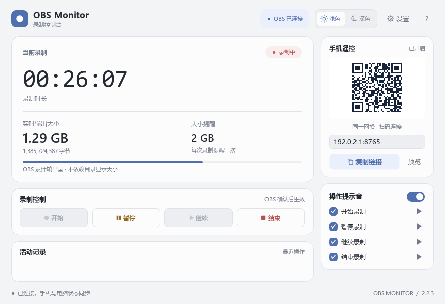
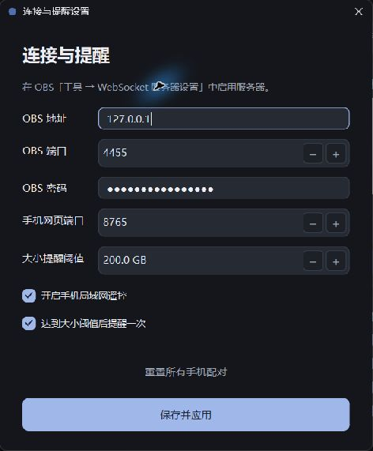
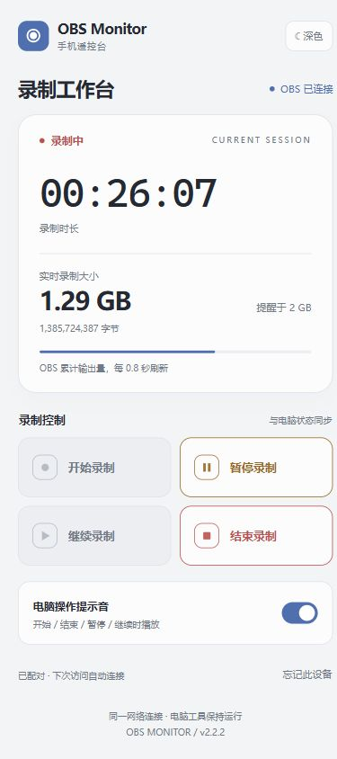
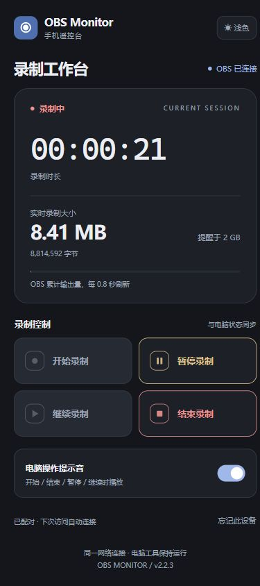

<p align="center">
  
</p>

# OBS Monitor

�ڵ��Ի��ֻ��Ͽ��� OBS ¼�ƣ�ʵʱ�鿴¼��ʱ�����ۼ������С��

OBS Monitor ��һ�� Windows ���湤�ߡ��ֻ�ͨ����������ҳ���ӣ����谲װ�ֻ� App���״���Ժ󣬿�����ʱ�ر���������´η����Զ��ָ����ӡ�

**[�������°�](https://github.com/ElmaTony/obs-monitor/releases/latest)** �� [���¼�¼](CHANGELOG.md) �� [��������](https://github.com/ElmaTony/obs-monitor/issues)



*����ʹ��ʾ�����ݣ�֧��dzɫ����ɫ���⡣*

## ��Ҫ����

| ���� | ˵�� |
| --- | --- |
| ¼�ƿ��� | ��ʼ����������ͣ�����������Ժ��ֻ�״̬ͬ�� |
| ʵʱ��С | ֱ�Ӷ�ȡ OBS �ۼ�����ֽ�����¼���ļ�������ʾ 0 KB ʱ�Կɸ��� |
| �ֻ�ң�� | ɨ���ճ��������ԣ��ر����������������� |
| �������� | ���ֲ����в�ͬ��ʾ�������ܹرջ�ֱ�ر� |
| ��С���� | �ﵽ�趨��ֵ�����ѣ�ÿ��¼������һ�� |
| ���ӻָ� | �����Զ��������ص��ֻ�ҳ��ʱ��������״̬ |
| ������� | ���ղ��֡�˫���⡢��ʵ������ |
| �״�ָ�� | �״������Զ���ʾʹ��˵����֮��ɵ����Ͻ��ʺŲ鿴 |

## ����

��ǰ�汾��**2.2.2**������ **[Windows x64 ���ļ� EXE](https://github.com/ElmaTony/obs-monitor/releases/download/v2.2.2/obs-monitor-2.2.2-windows-x64.exe)** ��ֱ�����У����谲װ Python��

[SHA-256 У���嵥](https://github.com/ElmaTony/obs-monitor/releases/download/v2.2.2/SHA256SUMS.txt) �� [��ǰ�汾Դ��](https://github.com/ElmaTony/obs-monitor/tree/v2.2.2) �� [��ʷ���а汾](https://github.com/ElmaTony/obs-monitor/releases)

����Ҫ��Windows 10 / 11 x64����Ҫ���ⰲװ֧�� **WebSocket v5** �� OBS Studio��

���淢�� **x64 ���ļ�����**�� `SHA256SUMS.txt` У���嵥��GitHub �Զ��ṩ�� **Source code (zip / tar.gz)** ���ڲ鿴Դ���[����˵��](#����)���У�Դ��ֿ��в���������õ� EXE��Windows ARM64 ����֤��Χ��Դ���Զ����ԣ����治���� ARM64 ����

## ���ٿ�ʼ

### ���Զ�

1. �� OBS���� **���� �� WebSocket ����������** �����÷�������Ĭ�϶˿�Ϊ `4455`��
2. ���� OBS Monitor���״��������Զ���ʾʹ��˵�������߻᳢�Զ�ȡ���� OBS ���ã�δ����ʱ��������Ͻ� **����**����д�� OBS һ�µĵ�ַ���˿ں����롣
3. ���ӳɹ������ĸ�¼�ư�ť���� OBS���������غ͸�������������ťλ���Ҳࡣ

<details>
<summary>�鿴���ý���</summary>

<p></p>

</details>

### �ֻ���

1. �ֻ����������ͬһ�����������Խ����ߡ��ֻ�����ͬһ·������ Wi-Fi Ҳ���ԡ�
2. ɨ����Թ����еĶ�ά�룬��� **��������** �õ���������ַ��Ĭ���ֻ���ҳ�˿�Ϊ `8765`��
3. �״���Գɹ��󣬿��Խ�ҳ�������ǩ��֮����ͬһ���������ͬһ���Ե�ַ�����Զ��ָ����ӡ�

<details>
<summary>�鿴�ֻ�����</summary>

<p></p>

<p></p>

</details>

## �������������

¼��ʱ�����л����� App���رձ�ǩҳ���˳������������һֱ����ҳ��򿪡����Թ���������Ҳ�ᱣ����ԣ��ֻ�����ҳ��ʱ�����¶�ȡ��ǰ¼��״̬��

- **���Ǵ��豸**�������ǰ���������ԡ�
- **���������ֻ����**���ڵ��������в��������о����Ӻ���������������Ҫ�������ӡ�
- **��Ҫ������Ե����**���޺۴��ڹرա������վ���ݡ����������������Զ���������ԡ�
- **���Ե�ַ�仯**��IP ����ҳ�˿ڸı����ʹ�ù�����ʾ�������ӡ�

�ֻ�ң���ڼ䣬���Թ�����Ҫ�������С��������Ӱ���ң��ƾ֤����ֻ�����������豸�����ڿ��ž�������ʹ�á�

## ʵʱ¼�ƴ�С˵��

¼���е��ļ�������ʱ��ʾ **0 KB**��OBS Monitor ��ȡ���� OBS �� `GetRecordStatus.outputBytes`���������ļ����ԣ�Ҳ�������ʹ��㣻����ͬʱ��ʾԭʼ�ֽ����ͱ����Ķ��� KB / MB / GB��

���������ʾ **OBS �ۼ������**������ MKV / MP4 �ļ���������װ��Ϣ���ļ����ȿ����������ͬ��

����Լÿ 0.5 ����£��ֻ�ǰ̨Լÿ 0.8 ����¡����߻����ݹ���ʱ��ҳ������ϴ���Ч���ݲ���ʱ����¼�ư�ť�������ɹ��� OBS ��ʵ��״̬ȷ��Ϊ׼��

## ��������

### �ֻ��򲻿�ҳ��

ȷ�ϵ��Թ����������У���ʹ�ù�����ʾ�ľ��������ӡ�`127.0.0.1` �������Ա������ʡ�

��� Windows ����ǽ�Ƿ����� OBS Monitor ͨ��ר�����磬�ֻ��͵���֮���Ƿ���� VPN���ÿ� Wi-Fi ���豸���롣OBS �����Ӷ˿�Ĭ���� `4455`���ֻ���ҳ�˿�Ĭ���� `8765`��

### Ϊʲô���ְ�ť�ǻ�ɫ�ģ�

��ť��¼��״̬�仯��׼������ʱ�ɿ�ʼ��¼���п���ͣ���������ͣ��ɼ�������������ڴ��������������жϻ����ݹ���ʱ����Ҫ�ȴ�����״̬��

### OBS ��ʾ�޷���ͣ

��� OBS ��¼�Ʊ��������Ƿ�֧����ͣ������ֱ����ͬ�ı������������ÿ��ܲ�֧�֣���ʹ��֧����ͣ�Ķ���¼�Ʊ�������

### �رչ��߻�ֹͣ¼����

���ڽ��е�¼�ƻ�������ر� OBS Monitor ��ر��������Ӻ��ֻ���ҳ����֮���Կ��� OBS �в���¼�ơ�

### ���������

�˳� OBS Monitor�������°� EXE���滻ԭ������������С�ͬһ Windows �û������ú��ֻ���Իᱣ����OBS �����ڽ��е�¼�ƻ���������� IP ���ֻ���ҳ�˿ڱ仯ʱ����ʹ�ù�����ʾ�������ӡ�

### ���ú����뱣�������

���ü�ʹ��˵����չʾ״̬������ `%APPDATA%/OBSAudioMonitor/config.json`�����ø�Ŀ¼�Լ����������á�OBS ������ֻ����ƾ֤�ֱ𱣴��� Windows ƾ�ݹ������У����Dz���д��Դ��Ŀ¼��

## ����

<details>
<summary>Դ�����������</summary>

Դ������ʹ�� Windows �� Python 3.12���ֻ��ű�������Ҫ Node.js 22 ����°汾��

```powershell
git clone https://github.com/ElmaTony/obs-monitor.git
cd obs-monitor
python -m venv .venv
.\.venv\Scripts\python.exe -m pip install -r requirements-dev.txt
.\.venv\Scripts\python.exe main.py
```

���в��ԣ�

```powershell
.\.venv\Scripts\python.exe -B -m unittest discover -v
node test_mobile.cjs
node test_mobile_races.cjs
node test_mobile_pairing.cjs
```

���Ը���¼�ƿ��ơ�ԭʼ�ֽڡ����������á��־���ԡ����ӻָ���������Ӧ��v2.2.2 ��ͨ�� Windows x64 �� ARM64 ��[Դ���Զ�����](https://github.com/ElmaTony/obs-monitor/actions/runs/42009205159)���Լ� x64 EXE ��ģ�� OBS ���������ֻ��ű�����ʹ��ģ�������������ʵ���ֻ����硢����ǽ��������������ʹ�û���ȷ�ϡ�

����Լ���� [CONTRIBUTING.md](CONTRIBUTING.md)����ȫ˵���� [SECURITY.md](SECURITY.md)��

</details>

## ����֤

����Ŀ�� [GPL-3.0-only](LICENSE) �����������������ѭ��������֤����� [NOTICE.txt](NOTICE.txt) �� [licenses/](licenses/)��

OBS Studio ��Ҫ������װ��OBS Monitor �Ƕ�����Ŀ���� OBS Studio ��������ϵ��
