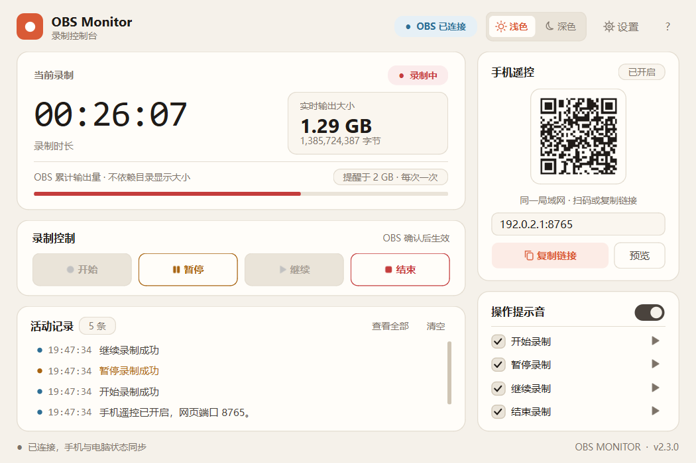
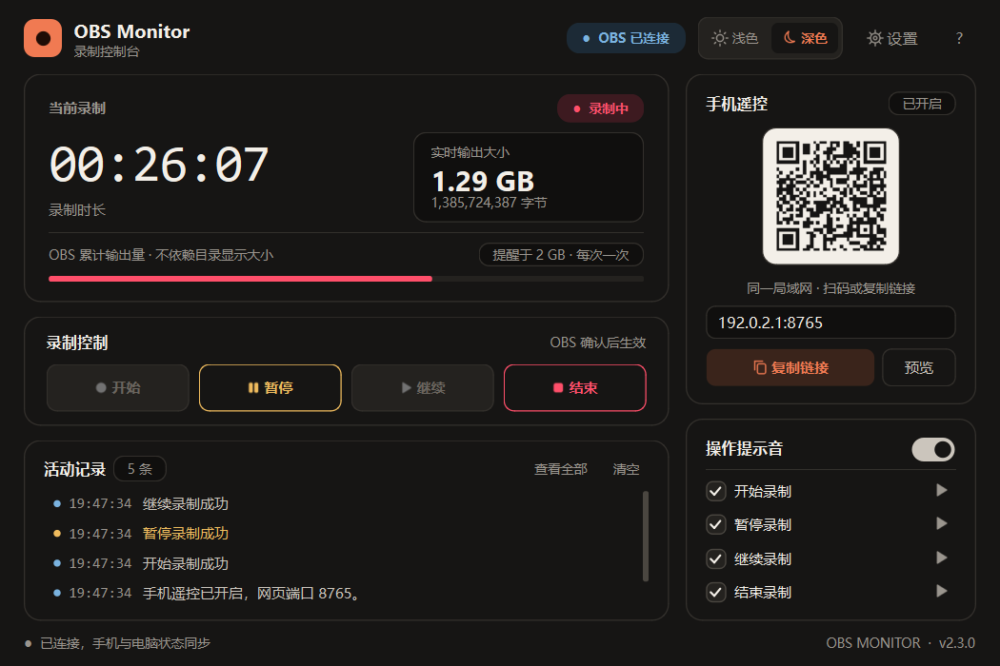
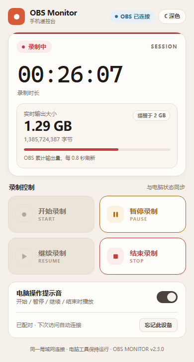
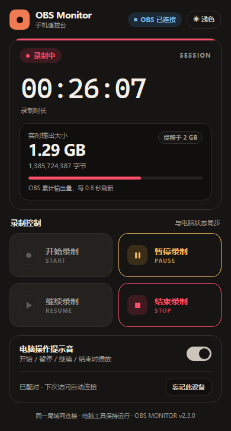
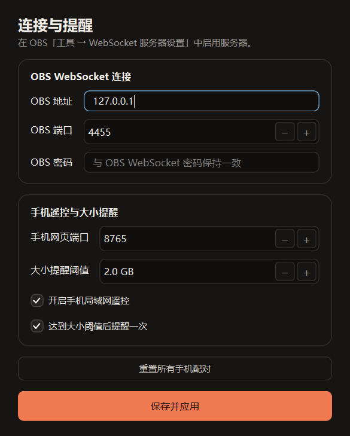

<div align="center">
  

  <h1>OBS Monitor</h1>

  <p>
    <a href="README.md">简体中文</a> · <strong>English</strong>
  </p>

  <p><strong>A lightweight, reliable Windows recording console and LAN mobile remote for OBS Studio</strong></p>
  <p>Track recording duration and real-time output bytes live, and start, pause, resume, or stop recordings from your phone by scanning a QR code.</p>

  <p>
    <a href="#download"><strong>Download v2.3.1</strong></a> ·
    <a href="#screenshots">Screenshots</a> ·
    <a href="#quick-start">Quick Start</a> ·
    <a href="#faq">FAQ</a> ·
    <a href="CHANGELOG.md">Changelog</a> ·
    <a href="https://github.com/ElmaTony/obs-monitor/issues">Issues</a>
  </p>

  <br>

  <picture>
    <source media="(prefers-color-scheme: dark)" srcset="assets/desktop-dark.png">
    <source media="(prefers-color-scheme: light)" srcset="assets/desktop-light.png">
    
  </picture>

  <p><sub>Sample data shown · Automatically adapts to your GitHub light/dark theme</sub></p>
</div>

---

## Key Features

| Feature | Description |
| --- | --- |
| **Confirmed Recording Controls** | Start, pause, resume, and stop OBS recordings. Every command waits for actual OBS state confirmation before reporting success or playing feedback, preventing duplicate submissions and accommodating long encoder drain times at fractional FPS. |
| **Real-Time Output Size** | Reads `GetRecordStatus.outputBytes` directly via OBS WebSocket v5, displaying both exact raw bytes and human-readable units even when the recording file still reports `0 KB` in File Explorer. |
| **App-Free Mobile Remote** | Scan the QR code or open the pairing link on the same LAN to control recordings and toggle desktop audio cues. Persistent pairing automatically reconnects after closing the browser, switching apps, or restarting the desktop tool. |
| **Per-Action Audio Cues & Size Alert** | Distinct sound cues for start, pause, resume, and stop with a master mute toggle, per-action switches, and preview buttons. Plays a one-time alert per recording when output crosses your custom size threshold. |
| **Structured Activity Log** | Displays a live event feed with status dots and monospace timestamps right in the main window, plus a dedicated full-log viewer (live sync, resize reflow, one-click copy) and quick clear action. |
| **Warm Light & Dark Compact UI** | Fixed `840×560` compact desktop window (with safe fallback on smaller screens), smooth transitions between Warm Sand Coral (light) and Warm Charcoal Coral outline cards (dark), theme-matched Windows title bar, single-instance guard, and first-run guide. |

---

## Screenshots

### Desktop Light & Dark Themes

<table>
  <tr>
    <td align="center" width="50%">
      <br>
      <sub>Light · Warm Sand Coral</sub>
    </td>
    <td align="center" width="50%">
      <br>
      <sub>Dark · Warm Charcoal Coral (outline cards)</sub>
    </td>
  </tr>
</table>

### Mobile Web Remote & Settings Dialog

<details>
<summary>Expand to view mobile light/dark remote pages and desktop settings dialog</summary>

<br>

<table>
  <tr>
    <td align="center" width="33%">
      <br>
      <sub>Mobile · Light</sub>
    </td>
    <td align="center" width="33%">
      <br>
      <sub>Mobile · Dark</sub>
    </td>
    <td align="center" width="34%">
      <br>
      <sub>Desktop · Connection & Alerts</sub>
    </td>
  </tr>
</table>

</details>

---

## Download

Current stable release: **v2.3.1** (all packages bundle the full runtime; no Python installation required).

| Platform | Installer (Recommended) | Portable (ZIP) | Single-File EXE |
| --- | --- | --- | --- |
| **Windows x64** (Intel / AMD) | [Download Setup](https://github.com/ElmaTony/obs-monitor/releases/download/v2.3.1/obs-monitor-2.3.1-windows-x64-setup.exe) | [Download ZIP](https://github.com/ElmaTony/obs-monitor/releases/download/v2.3.1/obs-monitor-2.3.1-windows-x64-portable.zip) | [Download EXE](https://github.com/ElmaTony/obs-monitor/releases/download/v2.3.1/obs-monitor-2.3.1-windows-x64.exe) |
| **Windows ARM64** (ARM PCs) | [Download Setup](https://github.com/ElmaTony/obs-monitor/releases/download/v2.3.1/obs-monitor-2.3.1-windows-arm64-setup.exe) | [Download ZIP](https://github.com/ElmaTony/obs-monitor/releases/download/v2.3.1/obs-monitor-2.3.1-windows-arm64-portable.zip) | [Download EXE](https://github.com/ElmaTony/obs-monitor/releases/download/v2.3.1/obs-monitor-2.3.1-windows-arm64.exe) |

- **Installer**: Creates Start Menu shortcuts and registers a standard uninstaller.
- **Portable**: Extract anywhere and run immediately—great for USB drives or zero-install setups.
- **Single-File EXE**: Standalone executable ready to launch without extraction.

[Complete Release Source](https://github.com/ElmaTony/obs-monitor/releases/download/v2.3.1/obs-monitor-2.3.1-source.zip) · [SHA-256 Checksums](https://github.com/ElmaTony/obs-monitor/releases/download/v2.3.1/SHA256SUMS.txt) · [All Releases](https://github.com/ElmaTony/obs-monitor/releases)

> **Requirements**: Windows 10 / 11 x64 or Windows 11 ARM64, and OBS Studio with **WebSocket v5** support (built into OBS 28+).

---

## Quick Start

### 1. Enable WebSocket Server in OBS
Open OBS Studio, go to **Tools → WebSocket Server Settings**, enable the server (default port `4455`), and note your server password if authentication is enabled.

### 2. Launch the Desktop Console
Start OBS Monitor. A quick-start guide appears on first launch (reopen anytime via the top-right **?** button):
- OBS Monitor automatically attempts to detect your local OBS WebSocket settings.
- If it does not connect automatically, click **Settings** in the top-right corner, enter the matching OBS host, port, and password, and click **Save & Apply**.
- Once connected, control recording with the four main buttons and manage sound cues on the right panel.

### 3. Pair Your Phone
1. Connect your phone and PC to the **same local network** (a wired PC and a phone on the same router's Wi-Fi work fine).
2. Scan the QR code on the right panel, or click **Copy Link** and open it in your phone's browser (default web port `8765`).
3. Once paired, bookmark the page or add it to your home screen. Reopening the same URL in the same browser reconnects automatically.

---

## How It Works

### Mobile Pairing & Reconnection
- **Seamless Recovery**: Switch apps, lock your phone, close tabs, or even restart OBS Monitor on your PC—reopening the page immediately syncs the live recording state.
- **Automatic Network Updates**: Monitors network adapter changes in the background and refreshes the QR code automatically, preferring LAN addresses reachable by your phone over virtual adapters.
- **Revoking Access**:
  - **Forget This Device** (on phone): Clears pairing only for the current browser.
  - **Reset All Phone Pairings** (in desktop settings): Immediately revokes every previous pairing link and browser session; all devices must scan the new QR code.
- **When Re-Pairing Is Needed**: Closing a private/incognito window, clearing site data, switching browsers, resetting all pairings from desktop settings, or changing the PC's LAN IP or remote web port.
- **Security Note**: The pairing link contains remote-control credentials. Share it only with trusted devices on a trusted LAN. Keep the desktop app running while using the mobile remote.

### Live Output Size & State Sync
- **Why Explorer Shows `0 KB`**: Windows often reports `0 KB` while a recording is still open. OBS Monitor queries OBS's cumulative output counter (`GetRecordStatus.outputBytes`) rather than file metadata or bitrate estimates. Because final MKV/MP4 files also include container overhead, the final file size on disk may differ slightly from the cumulative byte count.
- **Sync Cadence & Safety**: Desktop refreshes every ~`0.5 s` and mobile foreground refreshes every ~`0.8 s` (polling pauses automatically in the background and syncs immediately upon return). If disconnected or data becomes stale, the UI retains the last valid reading and disables recording buttons to prevent blind actions.

---

## FAQ

<details>
<summary><strong>My phone cannot open the remote page</strong></summary>

1. Verify that OBS Monitor is running on your PC and the mobile remote status badge shows enabled.
2. Open the LAN address displayed by OBS Monitor (e.g. `192.168.x.x:8765`); `127.0.0.1` is reachable only on the PC itself.
3. Check that Windows Firewall allows OBS Monitor on Private networks, and rule out VPNs, proxy clients, guest Wi-Fi, or router AP isolation.
4. Default ports: `4455` for OBS WebSocket and `8765` for the mobile web remote.

</details>

<details>
<summary><strong>Why are some recording buttons grayed out?</strong></summary>

Buttons strictly reflect the live OBS state:
- **Idle**: Only **Start** is enabled.
- **Recording**: Only **Pause** and **Stop** are enabled.
- **Paused**: Only **Resume** and **Stop** are enabled.
- **Awaiting confirmation / Disconnected / Stale data**: Controls lock temporarily until OBS confirms the transition or connection recovers.

</details>

<details>
<summary><strong>OBS says pausing is not supported</strong></summary>

Open OBS **Settings → Output → Recording**. If your recording encoder is set to *Use stream encoder*, OBS cannot pause recordings. Switch to an independent recording encoder (e.g., NVENC, QuickSync, or x264) to enable pause and resume.

</details>

<details>
<summary><strong>Does closing OBS Monitor stop my active recording?</strong></summary>

No. Closing OBS Monitor only disconnects WebSocket and stops the local mobile web server. Any active OBS recording continues uninterrupted and can still be controlled directly in OBS Studio.

</details>

<details>
<summary><strong>How do I upgrade to a newer version?</strong></summary>

Exit the running OBS Monitor instance first:
- **Installer**: Run the new installer directly to upgrade in place.
- **Portable**: Extract the new archive to a fresh folder.
- **Single-File EXE**: Replace the existing `obs-monitor.exe`.

Your settings, OBS password, and mobile pairings for the current Windows user are preserved, and active OBS recordings are unaffected.

</details>

<details>
<summary><strong>Where are settings, OBS passwords, and pairing credentials stored?</strong></summary>

- General settings, theme preference, and first-run guide state are stored in `%APPDATA%/OBSAudioMonitor/config.json` (kept under this folder name for backward compatibility).
- Your OBS WebSocket password and mobile pairing secret are stored separately in **Windows Credential Manager**, never written in plaintext into the app or source directory.

</details>

---

## Development

<details>
<summary>Expand for running from source, automated tests, and building release packages</summary>

### Prerequisites
- Windows 10 / 11
- Python 3.12+
- Node.js 22+ (for mobile frontend logic tests)

### Run from Source

```powershell
git clone https://github.com/ElmaTony/obs-monitor.git
cd obs-monitor
python -m venv .venv
.\.venv\Scripts\python.exe -m pip install -r requirements-dev.txt
.\.venv\Scripts\python.exe main.py
```

### Run Tests

```powershell
.\.venv\Scripts\python.exe -B -m unittest discover -v
node test_mobile.cjs
node test_mobile_races.cjs
node test_mobile_pairing.cjs
```

- Automated tests include 148 Python unit/UI tests and 42 mobile script tests covering recording controls, state confirmation, fractional-FPS encoder drain handling, raw output bytes, sound cues, settings validation, persistent pairing, reconnection, desktop UI regressions, and out-of-order request races.
- Source code is checked automatically on native Windows x64 and ARM64 runners via [GitHub Actions](https://github.com/ElmaTony/obs-monitor/actions); release builds undergo simulated OBS WebSocket v5 integration checks, single-instance tests, and silent install/uninstall smoke tests on both architectures.
- Real-hardware baseline: Verified on 2026-11-16 on Windows x64 with OBS Studio 33.0.1 (1080p60 / NVENC H.264 / MKV) and Android Chrome across all four controls, raw output byte parity, cookie-based reconnection, pairing persistence across restarts, and 1-frame-per-6-seconds stop drain.

### Build Release Packages
The complete release source archive (`obs-monitor-2.3.1-source.zip`) includes `BUILDING.md` and packaging scripts to build native x64 and ARM64 installers, portable archives, and single-file executables on Windows.

See [CONTRIBUTING.md](CONTRIBUTING.md) and [SECURITY.md](SECURITY.md) for contribution guidelines and security reporting.

</details>

---

## License

Licensed under [GPL-3.0-only](LICENSE). Third-party notices and licenses are available in [NOTICE.txt](NOTICE.txt) and [licenses/](licenses/).

OBS Studio must be installed separately. OBS Monitor is an independent open-source project and is not affiliated with OBS Studio.
